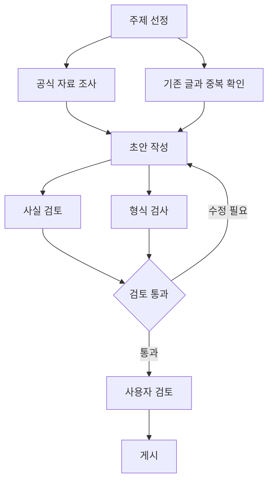

AI를 사용하다 보면 비슷한 지시를 반복하게 된다. 작업 전에 관련 파일을 읽고, 정해진 형식으로 결과를 만들고, 완료 전에 검증하라는 요청이다. 이런 절차를 대화할 때마다 직접 전달하는 대신 파일과 도구로 구성하면 반복해서 사용할 수 있다.

Codex에는 이를 위한 지침, 스킬, 훅, 하위 에이전트, 외부 도구 연결 기능이 있다. 각각의 역할을 이해하면 AI에게 업무를 맡기는 방식을 설계할 수 있다.

이 글에서는 먼저 Codex의 기능을 정리하고, 이를 프롬프트·컨텍스트·하네스·루프·그래프 엔지니어링과 연결한다. 마지막에는 만들어 둔 설정을 다른 컴퓨터나 포맷한 환경으로 옮기는 방법을 정리한다.

기능과 경로는 2026년 11월 공식 문서를 기준으로 작성했다.
Codex 기능
AGENTS.md: 프로젝트의 상시 작업 지침
AGENTS.md는 Codex가 프로젝트에서 작업할 때 참고하는 지속적인 지침이다. 프로젝트 설명, 코드 작성 규칙, 검증 방법, 완료 기준 등을 기록한다.

시스템 프롬프트와 비슷한 용도로 느껴질 수 있지만, 정확히는 프로젝트가 제공하는 작업 지침 파일이다. 이 파일을 작성한다고 모델의 시스템 지침이나 실행 권한이 변경되는 것은 아니다.
# AGENTS.md

## 작업 절차
- 변경 전에 관련 코드와 기존 테스트를 확인한다.
- 수정 후 영향받는 테스트를 실행한다.
- 최종 답변에 변경 파일, 테스트 결과, 남은 위험을 적는다.

## 제약
- 공개 API의 이름을 변경하기 전에 호출처를 확인한다.
- 테스트 실패를 무시하거나 테스트를 삭제해 통과시키지 않는다.
개인 공통 지침은 ~/.codex/AGENTS.md에, 프로젝트 지침은 저장소의 루트나 하위 디렉터리에 둘 수 있다. Codex는 시작 시 적용할 지침을 수집하며, 같은 디렉터리에서는 AGENTS.override.md를 AGENTS.md보다 우선한다. 하위 디렉터리 지침으로 해당 영역의 규칙을 구체화할 수도 있다.

따라서 “매 요청마다 파일 전체를 다시 읽는다”보다 작업을 시작할 때 적용할 지침을 구성한다고 이해하는 편이 정확하다. 또한 지침은 AI의 행동을 안내하므로, 특정 행동을 기계적으로 차단하려면 별도의 실행 통제가 필요하다. 공식 문서: AGENTS.md
SKILL.md: 반복 업무를 재사용하는 단위
스킬은 특정 작업의 절차와 판정 기준을 기록한 재사용 가능한 업무 단위다. 개발에 빗대면 함수나 모듈과 비슷하다. 필요한 작업에서 호출하고, 그 작업에 해당하는 절차를 적용한다.

예를 들어 릴리스 전 보안 검토를 반복한다면 다음과 같이 작성할 수 있다.
---
name: release-security-review
description: 릴리스 전 변경 사항의 보안 위험을 점검할 때 사용
---

1. 변경 파일과 외부 입력 경로를 확인한다.
2. 인증, 권한, 비밀정보 처리 변경을 조사한다.
3. 재현 가능한 문제만 심각도로 분류한다.
4. 각 발견에 근거 파일과 재현 조건을 적는다.
5. 발견이 없으면 확인한 범위와 미확인 범위를 적는다.
하나의 스킬은 SKILL.md가 포함된 폴더다. 필요하면 검사 스크립트, 결과물 템플릿, 참고 문서도 함께 넣는다.
release-security-review/
├── SKILL.md
├── scripts/
├── references/
└── assets/
Codex의 프로젝트 스킬은 .agents/skills/, 사용자 공통 스킬은 ~/.agents/skills/에서 관리할 수 있다. 저장소 내부에서는 현재 디렉터리부터 저장소 루트까지 스킬을 찾는다.

호출은 명시적·암시적으로 이루어진다. CLI에서는 /skills로 선택하거나 $release-security-review처럼 언급할 수 있다. 작업이 스킬의 description과 일치하면 Codex가 자동으로 선택할 수도 있다. 처음에는 이름과 설명을 보고, 선택한 뒤 본문과 필요한 부속 자료를 읽는다. 공식 문서: 스킬 작성
Hooks: 정해진 시점에 실행하는 프로그램
훅은 Codex의 특정 실행 시점에 연결하는 자동 처리다. 설정 파일은 hooks.md가 아니라 hooks.json이며, config.toml 안에 작성할 수도 있다.

대표 위치는 개인용 ~/.codex/hooks.json과 프로젝트용 .codex/hooks.json이다. 프로젝트 훅은 프로젝트 신뢰 설정을 따르며, 새로 추가하거나 변경한 훅은 검토하고 신뢰해야 실행된다.
이벤트	실행 시점	활용 예
SessionStart	세션 시작·재개 등	작업 상태 불러오기
UserPromptSubmit	사용자 요청 제출 시	필요한 맥락 추가
PreToolUse	지원되는 도구 실행 전	입력 검사·실행 차단
PostToolUse	지원되는 도구 실행 후	결과 검사
SubagentStart / SubagentStop	하위 에이전트 시작·종료	역할별 처리
Stop	답변을 끝내려 할 때	완료 조건 검사
SessionEnd	메인 세션 종료 시	종료 처리

핸들러에는 명령을 실행하는 command와 연결된 MCP 도구를 호출하는 mcp_tool 등이 있다.

예를 들어 Stop 검사 프로그램은 미완료 작업이 있을 때 다음 JSON을 출력할 수 있다.
{
  "decision": "block",
  "reason": "필수 검증이 완료되지 않았습니다. 검증을 수행하고 결과를 확인하세요."
}
이 출력은 Codex가 작업을 계속하도록 요청한다. 실제 검사는 별도 프로그램으로 구현해야 하며 반복 중단 조건도 필요하다. PostToolUse는 이미 실행된 동작을 되돌리지 못하고, 도구 훅이 모든 실행 경로를 포괄하지도 않는다. 공식 문서: Hooks
커스텀 하위 에이전트: 역할과 판단 기준의 분리
하위 에이전트는 별도 맥락에서 특정 작업을 수행하고 결과를 주 에이전트에게 전달한다. 커스텀 에이전트에는 역할, 판단 기준, 사용할 모델과 추론 수준 등을 지정할 수 있다.

개인용 정의는 ~/.codex/agents/, 프로젝트용 정의는 .codex/agents/에 TOML 파일로 저장한다.
name = "skeptical_reviewer"
description = "구현 결과에서 반례와 누락된 검증을 찾는 독립 검토자"

developer_instructions = """
구현자의 결론을 그대로 받아들이지 말고 코드를 직접 확인한다.
실제 재현 가능한 오류와 근거 파일을 우선 보고한다.
오류 조건, 영향 범위, 재현 방법을 구체적으로 적는다.
근거를 찾지 못하면 추측을 사실처럼 보고하지 않는다.
"""
다음과 같이 역할을 지정해 위임할 수 있다.
로그인 오류를 수정한 뒤 skeptical_reviewer에게 변경 사항을 검토하도록 맡겨 줘.

활용할 수 있는 역할은 다양하다.
역할	담당 작업
탐색자	관련 코드와 실행 경로 조사
구현자	변경 사항 구현과 테스트
검토자	반례·누락·회귀 오류 확인
문서 조사자	공식 문서와 구현의 일치 여부 확인

페르소나는 말투보다 무엇을 근거로 어떤 판단을 내릴지 구체적으로 지정할 때 유용하다. “꼼꼼한 전문가”보다 “변경된 함수의 호출처를 확인하고, 실패 입력과 근거 파일을 제시하는 검토자”가 평가하기 쉽다.

하위 에이전트는 부모의 샌드박스·승인 설정과 MCP 연결을 상속한다. 커스텀 에이전트 파일에 “읽기 전용”이라고 적어도 별도 샌드박스가 생기지는 않는다. 실행 권한을 실제로 분리하려면 별도 세션이나 외부 실행 환경 등에서 권한을 구성해야 한다. 공식 문서: 하위 에이전트
MCP와 플러그인: 외부 기능의 연결과 배포
MCP는 AI가 외부 시스템의 도구와 자료를 사용할 수 있도록 연결하는 프로토콜이다. MCP 서버는 검색, 파일 조회, 업무 시스템 처리 같은 기능을 도구로 제공한다.

예를 들어 OpenAI 공식 문서를 조회하는 MCP 서버는 다음 명령으로 연결할 수 있다.
codex mcp add openaiDeveloperDocs --url https://developers.openai.com/mcp
codex mcp list
이 서버는 공식 문서 검색과 읽기 전용이다. 연결한 뒤 관련 작업에서 사용하도록 AGENTS.md에 지침을 추가할 수 있다. 공식 문서: Docs MCP

스킬과 MCP는 함께 사용할 수 있다. MCP가 자료를 조회하고 작업을 실행하는 도구를 제공하면, 스킬은 그 도구를 사용하는 업무 절차를 알려준다.

플러그인은 스킬과 MCP 연결 등을 묶어 설치·배포하는 패키지다. 예를 들어 사내 보고서 플러그인에 보고서 작성 스킬과 데이터 조회 MCP를 함께 넣을 수 있다. 지원되는 수동 설치 데스크톱 플러그인에는 훅도 포함할 수 있다. 공식 문서: 플러그인
Rules: 명령 실행 정책
Rules는 셸 명령을 실행할 때 적용하는 정책이다. .rules 파일에 Starlark 문법의 prefix_rule()을 작성해 명령 접두어별 결정을 지정한다.
prefix_rule(
    pattern = ["git", "push"],
    decision = "prompt",
    justification = "원격 저장소에 반영하기 전에 확인",
    match = ["git push origin main"],
)
decision에는 allow, prompt, forbidden을 사용한다. 사용자 규칙은 ~/.codex/rules/, 프로젝트 규칙은 신뢰된 .codex/rules/에서 관리할 수 있다. 여러 규칙이 일치하면 더 제한적인 결정이 우선한다. 공식 문서: Rules

지침, 스킬, 훅, 규칙, 샌드박스는 다음처럼 구분할 수 있다.
수단	담당하는 질문
지침·스킬	어떤 방식으로 일해야 하는가?
훅	어느 시점에 무엇을 검사·처리할 것인가?
Rules	이 명령을 실행하도록 허용할 것인가?
샌드박스	어떤 파일·네트워크·환경에 접근할 수 있는가?
승인 정책	어떤 상황에서 사용자의 확인을 받을 것인가?
외부 서비스 권한	연결된 계정으로 어떤 작업을 할 수 있는가?

예를 들어 스킬에서 “배포 전 검토”를 안내하고, 훅으로 검사 프로그램을 실행하고, 명령 규칙으로 원격 반영을 통제할 수 있다. 실행 권한의 전체 범위는 샌드박스와 연결된 서비스의 권한도 함께 결정한다. 공식 문서: 승인과 보안
Automations: 작업 시작의 자동화
Automations는 지정한 시간에 작업을 실행하는 예약 기능이다. 스킬과 결합하면 반복 업무를 자동화할 수 있다.
매주 금요일 오후에 이번 주 변경 사항을 조사하고, 주간 보고서 스킬로 초안을 작성해 줘.

데스크톱의 프로젝트 예약 작업은 프로젝트 디렉터리나 격리된 Worktree에서 실행할 수 있다. 로컬 프로젝트 작업이 실행되려면 컴퓨터가 켜져 있고 앱과 프로젝트에 접근할 수 있어야 한다.

예약 실행과 이벤트 실행은 구분해야 한다. 공식 문서에 안내된 Gmail·Slack·GitHub 이벤트 트리거는 해당 웹·모바일 기능이며, 현재 데스크톱 앱과 CLI에서는 지원하지 않는다. 공식 문서: 예약 작업
Local, Worktree, Cloud: 작업을 실행할 장소
Codex의 실행 환경은 파일을 어디에서 읽고 변경할지 결정한다.
환경	실행 방식	적합한 상황
Local	현재 컴퓨터의 프로젝트에서 작업	직접 결과를 보며 작업
Worktree	같은 Git 저장소의 별도 작업 공간 사용	다른 변경과 분리해 병행
Cloud	원격 실행 환경에서 작업	준비된 원격 환경에 작업 위임

Worktree는 파일 변경을 분리하는 Git 기능이다. 여러 작업 공간이 저장소 메타데이터를 공유하므로, 별도의 보안 샌드박스와는 구별해야 한다.

Cloud 작업은 로컬 컴퓨터와 다른 환경에서 실행된다. 필요한 자료와 의존성, 도구를 해당 환경에서 사용할 수 있도록 준비해야 한다. 공식 문서: 실행 환경, Worktrees
Computer Use, 브라우저, Appshots, Record & Replay
화면을 사용하는 기능도 목적에 따라 나뉜다.
기능	역할	예시
Computer Use	앱 화면을 확인하고 조작	프로그램에서 자료 내보내기
인앱 브라우저·브라우저 확장	웹페이지 접근과 조작	로그인된 웹 서비스에서 업무 수행
Appshots	현재 앱 화면을 대화의 자료로 전달	오류 화면을 보여주고 분석 요청
Record & Replay	시연한 작업을 재사용 스킬로 변환	반복 업무를 직접 보여주고 절차 생성

브라우저 선택은 작업에 필요한 로그인 세션과 접근 가능한 도구에 따라 달라진다. Computer Use는 화면 조작이 필요한 업무에 활용하고, 서비스 도구가 제공되는 작업은 MCP나 플러그인으로 처리할 수도 있다.

Appshots는 macOS·Windows 데스크톱에서 지원하며 CLI에서는 새로 촬영할 수 없다. Record & Replay는 현재 macOS 기능이며, Computer Use가 활성화되어 있어야 한다. 공식 문서: Appshots, Record & Replay
모델·추론 노력·속도 설정
모델 선택은 작업의 정확도, 처리 시간, 비용에 영향을 준다. 추론 노력은 모델이 문제를 검토하는 정도를 조정하며, 높은 설정은 복잡한 작업에 도움이 될 수 있지만 더 많은 시간과 토큰을 사용한다.

속도 설정은 추론 노력과 별도로 확인할 항목이다. 사용할 수 있는 모델과 옵션은 계정·제품에 따라 달라진다. 모든 작업을 가장 높은 설정으로 실행하기보다, 대표 작업의 결과와 소요 시간을 비교해 선택하는 편이 좋다. 공식 문서: 모델
GitHub 코드 리뷰와 생성 도구
GitHub에 Codex 리뷰를 연결하면 PR에서 @codex review로 검토를 요청하거나 자동 리뷰를 구성할 수 있다. 팀의 검토 기준은 관련 AGENTS.md에 기록한다.
## Code Review Rules

- 인증과 권한 변경에서 접근 범위가 넓어지는지 확인한다.
- 데이터 변경에는 실패 시 복구 방법이 있는지 확인한다.
- 재현 가능한 오류와 근거를 중심으로 보고한다.
이 섹션은 리뷰 기준을 맞춤 설정하는 수단이며 GitHub 연동 자체를 대신하지는 않는다. 공식 문서: GitHub 리뷰

스킬을 직접 작성하기 어렵다면 [$skill-creator](C:\\Users\\CJY\\.codex\\skills\\.system\\skill-creator\\SKILL.md)로 생성을 요청하고, [$skill-installer](C:\\Users\\CJY\\.codex\\skills\\.system\\skill-installer\\SKILL.md)로 제공되는 스킬을 설치할 수 있다. 플러그인 생성 기능이 제공되는 환경에서는 Plugin Creator로 패키지 구성을 도울 수도 있다. 공식 문서: 스킬 작성과 설치, 플러그인 작성
AI Engineering
Codex 기능을 개별적으로 익힌 다음에는 이 기능들을 어떤 구조로 조합할지 생각할 수 있다.

학습에 참고한 영상은 프롬프트·컨텍스트·하네스·루프·그래프라는 구분을 제시한다. 이 구분은 AI 시스템의 설계 범위를 이해하는 데 유용하다. 각 개념을 블로그 운영 자동화에 적용해 보자.
Prompt Engineering: 목표와 조건 전달
프롬프트 엔지니어링은 모델에 전달하는 지시를 설계하는 일이다. 목표, 작업 범위, 제약, 결과 형식, 성공 기준을 구체화한다.
이번 주 AI 관련 공식 발표를 조사해 블로그 초안을 작성해 줘. 주요 주장에는 출처를 연결하고, 사실과 의견을 구분해 줘. 기존 글에서 이미 다룬 발표는 제외해 줘.

이 요청에는 조사 대상, 작성 목적, 근거 요구, 중복 제외 조건이 담겨 있다. 원하는 결과를 판단할 수 있도록 지시를 구성하는 것이 핵심이다.
Context Engineering: 판단에 필요한 정보 구성
컨텍스트 엔지니어링은 모델이 판단할 때 사용할 자료를 구성하는 일이다. 어떤 자료를 검색하고, 무엇을 전달하며, 이전 작업에서 어떤 정보를 유지할지 결정한다.

블로그 초안 작성에는 다음 자료가 필요할 수 있다.
- 이번 주 공식 발표와 문서.
- 기존에 발행한 글 목록.
- 블로그의 문체와 메타데이터 규칙.
- 독자 수준과 다룰 주제.
- 이전에 결정한 편집 기준.
자료를 많이 넣는 것만으로 충분하지는 않다. 이번 작업과 관련된 자료를 찾고, 출처와 시점을 구분하고, 필요한 부분을 사용할 수 있도록 구성해야 한다.

AGENTS.md, 참고 문서, 검색 결과, 스킬의 자료는 이러한 컨텍스트를 구성하는 데 사용된다.
Harness Engineering: 실행 환경과 통제 구성
하네스 엔지니어링은 모델 주변의 실행 체계를 설계하는 일이다. 도구 연결, 파일 접근, 상태 관리, 권한, 검증, 오류 처리가 여기에 포함된다.

블로그 작성 하네스에는 다음 요소가 들어갈 수 있다.
요소	구현 예
자료 접근	공식 문서 검색 도구와 MCP
작업 절차	블로그 작성 스킬
파일 처리	Markdown 저장 도구
검증	메타데이터·링크 검사 프로그램
실행 통제	훅·Rules·승인 정책
상태 관리	조사 자료와 작성 진행 기록

모델이 초안을 잘 쓰더라도 파일 저장이나 검증에 실패하면 전체 업무는 완료되지 않는다. 하네스는 이러한 실행 과정을 다룬다. OpenAI의 공식 예제도 하네스를 지침, 도구, 라우팅, 출력 요구사항, 검증을 포함한 실행 계약으로 설명한다. 공식 예제: 에이전트 개선 루프
Loop Engineering: 실행과 피드백의 반복
루프 엔지니어링은 작업 결과를 확인하고 다음 행동을 결정하는 반복 절차를 설계하는 일이다.
초안 작성 → 검사 → 통과하면 완료
                  └ 실패하면 수정 → 다시 검사
블로그 글이라면 출처가 없는 주장이나 잘못된 메타데이터를 찾아 수정하도록 만들 수 있다.

루프에는 종료 기준이 필요하다. “완벽해질 때까지 수정”보다 “필수 메타데이터와 링크 검사를 통과하면 완료하고, 출처를 찾지 못한 내용은 미확인으로 보고한다”처럼 정한다. 반복 횟수나 시간 한도도 작업에 맞게 설정할 수 있다.

이 반복이 모델의 가중치를 학습시키는 것은 아니다. 실행 결과를 근거로 작업물이나 지침을 수정하는 과정이다.
Graph Engineering: 작업 경로와 협업 구조
그래프 엔지니어링은 작업 단계와 그 사이의 연결을 명시적으로 설계하는 일이다. 순서, 조건 분기, 병렬 실행, 결과 통합, 반복, 사람의 승인 지점을 표현한다.

블로그 운영을 다음처럼 구성할 수 있다.

그래프의 노드는 에이전트, 일반 프로그램, 외부 도구, 사람의 승인 단계가 될 수 있다. 여러 에이전트를 사용하는 경우에는 각 역할에 어떤 자료와 결과를 전달할지도 정해야 한다.

단일 에이전트가 초안을 수정하는 반복도 그래프로 표현할 수 있다. 루프는 반복을, 그래프는 전체 실행 경로를 설명한다. LangGraph 공식 소개
다섯 개념의 관계
설계 항목	핵심 질문	Codex에서 연결되는 수단
프롬프트	무엇을 수행해야 하는가?	사용자 요청과 역할 지시
컨텍스트	무엇을 근거로 판단하는가?	프로젝트 문서·검색·참고자료
하네스	어떤 도구와 통제 아래 실행하는가?	MCP·훅·권한·상태 관리
루프	결과를 어떻게 확인하고 개선하는가?	검사·수정·재검증 절차
그래프	작업을 어떤 경로로 연결하는가?	위임·분기·병렬 실행·승인

각 항목의 경계는 일부 겹친다. 예를 들어 스킬에는 프롬프트와 절차가 들어 있고, 훅은 하네스의 일부이면서 검증 루프에도 사용된다. 이 분류는 시스템에서 어떤 책임을 설계하고 있는지 파악하는 데 활용할 수 있다.
이 구분은 공식 표준인가?
2026년 발표된 Graph Engineering in the Era of LLM Agents는 프롬프트, 컨텍스트, 하네스, 루프와 그래프를 연결해 설명하는 서베이 논문이다. 이러한 분류를 뒷받침하는 연구는 존재하지만, 이를 학계와 업계가 합의한 공식 5단계 표준이라고 단정하기는 어렵다. 서베이 논문

그래프 기반 에이전트와 다중 에이전트 워크플로도 2024년 LangGraph 공식 자료에서 이미 다뤘다. 따라서 다섯 용어를 기술이 순서대로 등장해 이전 단계를 대체한 역사로 받아들이기보다, 시스템의 설계 범위를 설명하는 관점으로 사용하는 편이 적절하다. 2024년 다중 에이전트 워크플로
안정적인 시스템을 만드는 평가와 기록
구조를 설계한 뒤에는 실제로 잘 작동하는지 확인해야 한다.

**평가(Evals)**는 대표 작업을 반복 실행해 결과를 측정하는 과정이다. 블로그 자동화라면 과거 자료를 사용해 출처 정확도, 중복 여부, 메타데이터 누락을 평가할 수 있다.

**실행 기록(Traces)**은 어떤 자료를 읽고, 어떤 도구를 사용하고, 어느 지점에서 실패했는지 남기는 기록이다.

이 둘을 연결하면 다음과 같은 개선 절차를 만들 수 있다.
실행 기록 수집
→ 반복되는 실패 확인
→ 실패 사례를 평가 항목으로 추가
→ 지침·도구·작업 경로 수정
→ 같은 평가를 다시 실행
개선 전후에 같은 평가를 수행하면 변경 효과를 비교할 수 있다. 에이전트 수를 늘리거나 복잡한 그래프를 도입하는 판단도 이 결과를 근거로 할 수 있다. 공식 예제: Traces·Evals·Codex를 이용한 개선
SDK는 어디에 사용하는가?
Codex 앱과 CLI는 이미 구성된 에이전트 실행 환경을 제공한다. 직접 서비스를 개발한다면 SDK나 API로 도구와 실행 절차를 애플리케이션에 통합할 수 있다.

OpenAI Agents SDK는 에이전트와 도구, 위임 등의 흐름을 애플리케이션에서 구성하는 데 사용한다. Responses API는 모델 호출과 도구 사용을 더 직접 제어하는 출발점이다.

SDK는 앞의 다섯 개념 위에 추가되는 단계가 아니라 이를 코드로 구현하는 수단이다. 프로젝트 자동화는 Codex 설정과 스킬부터 시작하고, 별도 서비스나 세밀한 실행 제어가 필요할 때 API와 SDK를 검토할 수 있다. 공식 문서: 에이전트 개발 선택지
설정의 공유와 이전
앱과 CLI가 공유하는 설정
Codex 데스크톱 앱과 CLI는 같은 설정 계층을 공유한다. 같은 Codex 홈과 프로젝트를 사용하면 지침, 스킬, 커스텀 에이전트, 훅, 명령 규칙을 재사용할 수 있다. 공식 문서: 설정 공유

프로젝트 전용 설정을 다음처럼 모으면 관리하기 쉽다.
project/
├── AGENTS.md
├── .agents/
│   └── skills/
│       └── blog-writing/
│           ├── SKILL.md
│           └── assets/
└── .codex/
    ├── config.toml
    ├── agents/
    ├── hooks.json
    ├── hooks/
    └── rules/
여기서 .codex/hooks/는 스크립트를 정리하기 위해 선택한 배치다. hooks.json에서 실제 스크립트 경로를 지정해야 한다.

이 파일들을 옮기면 설정을 재사용할 수 있다. 실행에는 Python·Node 같은 프로그램, MCP 서버, 로그인, 파일 경로, 프로젝트 신뢰 설정이 필요하다. 데스크톱 전용 화면 기능이 CLI에 추가되는 것은 아니며, Windows와 WSL처럼 실행 환경이 다르면 경로와 명령도 확인해야 한다.
포맷 전에 보관할 것
프로젝트 폴더와 사용자 설정은 서로 다른 위치에 있으므로 함께 보관해야 한다.
대상	보관 내용
프로젝트 전체	코드·문서·결과물·프로젝트 설정·Git 기록
별도 Worktree	원본 폴더에 없는 최신 변경
Codex 사용자 홈	개인 설정·지침·로컬 상태
개인 스킬	사용자 공통 스킬과 부속 자료
외부 의존 자료	DB·모델·참고파일·로컬 MCP 서버
작업 인계 기록	현재 상태·다음 작업·실행 방법

Codex 홈의 기본값은 ~/.codex이며 CODEX_HOME으로 변경할 수 있다. SQLite 상태도 별도 위치로 설정할 수 있다. 설치 방식에 따라 사용하는 스킬 위치가 다를 수 있으므로 실제 사용 경로를 확인한다. 공식 문서: 환경 변수

프로젝트에는 다음과 같은 인계 문서를 남겨둘 수 있다. HANDOFF.md는 복구를 돕기 위한 개인 관례다.
# 작업 인계

## 현재 목표
블로그 초안 작성과 검증 자동화.

## 완료
- 작성 스킬 구성.
- 메타데이터 검사 프로그램 작성.

## 다음 작업
- 실제 글을 대상으로 평가.
- 오류 사례를 평가 항목에 추가.

## 실행 방법
- 필요한 프로그램과 설치 명령.
- 검사 명령과 결과 위치.
- 외부 자료와 서비스 연결 위치.
포맷 후에는 앱·CLI와 실행 프로그램을 설치하고 파일을 복원한다. 경로·로그인·권한을 확인한 뒤 검사 명령을 실행하면 된다.

대화 동기화와 로컬 파일 복구는 별개다. 대화가 계정에 보인다고 프로젝트 전체가 복구되는 것은 아니다. 작업에 필요한 결정과 다음 단계를 프로젝트 문서에도 남겨두면 새 대화에서도 이어갈 수 있다. 공식 문서: 프로젝트와 대화
블로그 운영에 적용하기
내 블로그 자동화에는 다음 순서로 적용해 볼 수 있다.
1. AGENTS.md에 출처·문체·파일 저장 기준을 기록한다.
2. 글 작성 스킬에 조사부터 초안 저장까지의 절차와 템플릿을 묶는다.
3. 메타데이터와 링크처럼 프로그램으로 확인할 항목을 검사한다.
4. 작성과 사실 검토의 역할을 나누고 각 결과를 비교한다.
5. 실제 실패 사례를 평가에 추가하고 절차를 개선한다.
6. 반복 실행의 품질을 확인한 뒤 예약 작업으로 연결한다.
예를 들어 다음 요청 하나가 이 구성을 사용할 수 있다.
이번 주 공식 발표를 조사하고 블로그 작성 스킬로 초안을 만들어 줘. 주요 주장은 검토자에게 원문과 대조하도록 맡기고, 메타데이터 검사를 통과한 초안을 저장해 줘.

이 작업을 안정적으로 반복할 수 있는지는 작성된 글과 실행 기록, 검사 결과로 확인한다. 그 결과를 바탕으로 필요한 지침과 도구를 조금씩 추가해 갈 계획이다.
