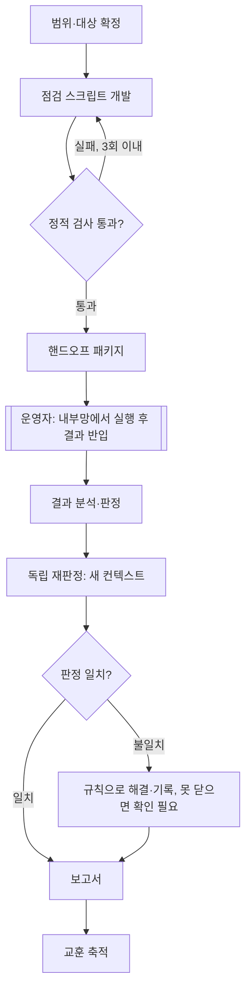

# Claude로 하는 AI Engineering

> Claude Code의 지침·스킬·훅·에이전트 기능을 살펴보고, 프롬프트부터 하네스·루프·그래프까지 AI 시스템 설계 개념에 연결한다. 마지막에는 이 개념으로 AI 시스템을 설계하는 순서를 정리한다.

앞 글에서는 Codex의 기능을 기준으로 AI 엔지니어링을 정리했다. 이번에는 같은 틀을 Claude Code에 적용한다. 반복되는 지시를 파일과 도구로 옮긴다는 생각은 같다. 다만 어떤 기능이 "안내"에 그치고 어떤 기능이 "강제"까지 하는지는 제품마다 다르다. 이 차이가 설계를 바꾼다.

기능과 경로는 2026년 11월 12일 기준 Claude Code 공식 문서(code.claude.com/docs)와 Claude Code에 함께 배포되는 Claude API 참조 문서로 확인했다. 실행 환경은 Windows 11의 VS Code 확장(v2.1.322)이다.

## 이 글의 실행 환경

같은 Claude Code라도 어디서 실행하느냐에 따라 쓸 수 있는 기능이 다르다. 먼저 내 환경을 확인했다.

| 항목 | 현재 상태 | 영향 |
|---|---|---|
| 사용 방식 | VS Code 확장만 사용, 데스크톱 앱 미설치 | 데스크톱 전용 기능(로컬 예약 작업, Windows 컴퓨터 사용)은 쓸 수 없다 |
| CLI | 확장 안에 전용 CLI가 들어 있지만 터미널의 `claude` 명령은 없다 | `claude mcp add`, `claude -p`, `claude --worktree` 같은 터미널 명령은 별도 설치가 필요하다 |
| OS | Windows 11 네이티브 | 샌드박스를 쓸 수 없다. 명령이 샌드박스 없이 실행된다 |
| 셸 | PowerShell과 Git Bash | 훅 명령의 실행 방식과 실패 처리에 영향을 준다 |
| 네트워크 | 사내 SSL 검사 장비 경유 | 일부 사이트에서 WebFetch가 인증서 오류를 낸다 |

몇 가지는 공식 문서로 확인한 내용이다.

- **확장과 CLI의 관계**: 확장은 채팅 패널용 CLI 사본을 내장하지만 셸 PATH에 `claude`를 넣지 않는다. 터미널에서 쓰려면 PowerShell에서 `irm https://claude.ai/install.ps1 | iex`로 독립 CLI를 설치한다. 확장과 CLI는 대화 기록을 공유하므로 `claude --resume`으로 확장에서 하던 대화를 이어갈 수 있다.
- **확장에서 빠지는 것**: 명령과 스킬은 일부만 제공된다(`/`를 입력해 확인). `!` 셸 단축키와 탭 자동완성은 CLI에만 있다. MCP 설정은 확장에서도 `/mcp` 대화상자로 할 수 있다.
- **샌드박스**: 샌드박스는 macOS, Linux, WSL2에서만 동작한다. 네이티브 Windows에서는 명령이 샌드박스 없이 실행되므로, 격리가 필요하면 WSL2 안에서 Claude Code를 실행해야 한다.
- **인증서**: Claude Code는 기본으로 내장 Mozilla CA 목록과 OS 인증서 저장소를 함께 신뢰한다. SSL 검사 장비가 같은 이름의 루트 인증서를 둘 이상 설치해 둔 PC에서는, 인증서 체인을 이름으로 찾는 검증기가 엉뚱한 루트를 골라 `certificate signature failure`를 낼 수 있다. 이때는 `CLAUDE_CODE_CERT_STORE`(신뢰할 저장소 선택)와 `NODE_EXTRA_CA_CERTS`(추가 CA 파일)로 신뢰 목록을 조정한다. 두 값은 `settings.json`의 `env`에 넣는다.

공식 문서: [VS Code](https://code.claude.com/docs/en/vs-code), [설치](https://code.claude.com/docs/en/setup), [샌드박스](https://code.claude.com/docs/en/sandboxing), [네트워크 설정](https://code.claude.com/docs/en/network-config)

## Codex 기능과의 대응

앞 글의 Codex 기능을 Claude Code 기능에 대응시키면 다음과 같다. 이름이 비슷해도 동작이 다른 곳이 있으니 오른쪽 열을 함께 본다.

| Codex | Claude Code | 눈여겨볼 차이 |
|---|---|---|
| AGENTS.md | CLAUDE.md, `.claude/rules/`, 자동 메모리 | AGENTS.md도 읽지만 CLAUDE.md가 없을 때만 읽는다 |
| `.agents/skills/` | `.claude/skills/<이름>/SKILL.md` | 같은 Agent Skills 표준이다. 누가 호출할지, 어떤 도구를 쓸지를 프론트매터로 정한다 |
| `hooks.json` | `settings.json`의 `hooks` 키 | 이벤트가 30개가 넘고 핸들러는 5종이다 |
| `.codex/agents/*.toml` | `.claude/agents/*.md` | `tools` 필드가 도구를 실제로 제한한다 |
| `codex mcp add` | `claude mcp add`, VS Code의 `/mcp` | 설정 범위가 local, project, user 세 가지다 |
| 플러그인 | 플러그인 | 스킬·에이전트·훅·MCP·mod를 하나로 묶는다 |
| Rules(`prefix_rule`) | 권한 규칙(allow, ask, deny) | deny, ask, allow 순서로 평가한다 |
| 샌드박스·승인 정책 | 권한 모드, `/sandbox` | 네이티브 Windows에서는 샌드박스가 없다 |
| Automations | 클라우드 예약 작업, 데스크톱 예약 작업, `/loop`, `/goal` | 실행 위치와 로컬 파일 접근 여부가 다르다 |
| Local, Worktree, Cloud | 로컬, `--worktree`, 클라우드 세션 | 클라우드 세션은 로컬 사용자 설정을 읽지 않는다 |
| Computer Use, 브라우저 | 컴퓨터 사용, Claude in Chrome | 컴퓨터 사용은 CLI에서는 macOS만, 데스크톱 앱에서는 macOS와 Windows를 지원한다 |
| 모델·추론 노력·속도 | `/model`, `/effort`, `/fast` | 스킬과 서브에이전트마다 모델과 노력 수준을 따로 줄 수 있다 |
| `@codex review` | Code Review, GitHub Actions의 `@claude`, `/code-review` | 리뷰 기준은 REVIEW.md에 쓴다 |
| `$skill-creator` | skill-creator 플러그인, `claude plugin eval` | 스킬과 플러그인을 평가하는 도구가 함께 있다 |
| Agents SDK, Responses API | Agent SDK, Client SDK, Managed Agents | 하네스를 누가 제공하고 어디서 실행하느냐로 고른다 |

## Claude Code 기능

### CLAUDE.md: 프로젝트의 상시 작업 지침

CLAUDE.md는 Claude가 세션을 시작할 때 읽는 지속 지침 파일이다. 프로젝트 설명, 작업 규칙, 검증 방법, 완료 기준을 적는다. 이 파일은 모델의 행동을 안내할 뿐이며, 권한을 바꾸거나 특정 행동을 막지는 않는다. 막아야 하는 것은 뒤에 나오는 권한 규칙과 훅으로 처리한다.

```markdown
# CLAUDE.md

## 작업 절차
- 변경 전에 관련 코드와 기존 테스트를 확인한다.
- 수정 후 영향받는 테스트를 실행한다.
- 최종 답변에 변경 파일, 테스트 결과, 남은 위험을 적는다.

## 제약
- 테스트를 삭제해서 통과시키지 않는다.
- 상세 규칙: @docs/coding-rules.md
```

파일은 위치에 따라 적용 범위가 다르다.

| 위치 | 경로 | 용도 |
|---|---|---|
| 조직 정책 | Windows: `C:\Program Files\ClaudeCode\CLAUDE.md` | IT 부서가 배포하는 전사 규칙 |
| 사용자 | `~/.claude/CLAUDE.md` | 모든 프로젝트에 적용할 개인 규칙 |
| 프로젝트 | `./CLAUDE.md` 또는 `./.claude/CLAUDE.md` | 저장소에 커밋해 팀과 공유 |
| 개인 프로젝트 | `./CLAUDE.local.md` | 이 프로젝트에서 나만 쓸 규칙(.gitignore에 추가) |

불러오는 방식에는 세 가지 특징이 있다.

- **덮어쓰지 않고 이어 붙인다**: 작업 디렉터리와 그 위 디렉터리의 CLAUDE.md를 시작할 때 모두 읽어 루트부터 순서대로 붙인다. 작업 위치에 가까운 파일이 마지막에 놓인다.
- **하위 디렉터리는 필요할 때 읽는다**: 하위 디렉터리의 CLAUDE.md는 Claude가 그 디렉터리의 파일을 읽거나 고칠 때 로드된다.
- **`@경로`로 다른 파일을 가져온다**: 최대 4단계까지 이어서 가져올 수 있다. 다만 가져온 파일도 함께 로드되므로 컨텍스트 비용은 줄지 않는다.

공식 문서는 CLAUDE.md 한 파일을 200줄 이하로 유지하라고 권장한다. 길어질수록 컨텍스트를 많이 쓰고 지시를 덜 따르기 때문이다. 일부 파일에만 해당하는 규칙은 `.claude/rules/`로 옮긴다. 규칙 파일에 `paths`를 지정하면 그 경로의 파일을 다룰 때만 로드된다.

```markdown
---
paths:
  - "src/api/**/*.ts"
---
# API 규칙
- 모든 엔드포인트에 입력 검증을 넣는다.
```

**AGENTS.md와 함께 쓰기**: v2.1.277부터 Claude Code는 AGENTS.md를 직접 읽는다. 단, 작업 디렉터리나 그 위에 CLAUDE.md가 없을 때만 읽는다. 두 파일이 모두 있으면 CLAUDE.md만 읽는다. Codex와 지침을 공유하려면 CLAUDE.md에 `@AGENTS.md` 한 줄을 넣어 가져오는 방법이 확실하다.

**자동 메모리**: Codex 글에서 다루지 않은 기능이다. Claude는 작업 중 알게 된 사실을 `~/.claude/projects/<프로젝트>/memory/`에 스스로 기록한다. 기록 종류는 user(사용자 정보), feedback(받은 교정), project(진행 중인 일), reference(외부 자료 위치) 네 가지다. 색인 파일 `MEMORY.md`의 앞 200줄(최대 25KB)이 매 세션 로드되고, 세부 메모는 필요할 때 읽는다. 메모리는 그 컴퓨터에만 저장되며 `/memory`로 확인하고 켜거나 끌 수 있다.

공식 문서: [메모리](https://code.claude.com/docs/en/memory)

### SKILL.md: 반복 업무를 재사용하는 단위

스킬은 특정 작업의 절차와 판정 기준을 묶은 재사용 단위다. CLAUDE.md는 항상 로드되지만 스킬은 설명(description)만 상시 로드되고 본문은 호출될 때 로드된다. 그래서 긴 절차나 참고자료를 넣어도 평소에는 비용이 거의 들지 않는다. 공식 문서도 같은 지시를 반복해서 붙여 넣거나 CLAUDE.md의 일부가 "사실"이 아니라 "절차"가 되었을 때 스킬로 옮기라고 안내한다.

```markdown
---
name: release-security-review
description: 릴리스 전 변경 사항의 보안 위험을 점검할 때 사용
allowed-tools: Read Grep Glob
context: fork
agent: Explore
---

1. 변경 파일과 외부 입력 경로를 확인한다.
2. 인증, 권한, 비밀정보 처리 변경을 조사한다.
3. 재현 가능한 문제만 심각도로 분류한다.
4. 각 발견에 근거 파일과 재현 조건을 적는다.
5. 발견이 없으면 확인한 범위와 미확인 범위를 적는다.
```

스킬은 SKILL.md가 들어 있는 폴더다. 스크립트, 템플릿, 참고문서를 함께 넣을 수 있다. Claude Code 스킬은 여러 AI 도구가 함께 쓰는 Agent Skills 공개 표준(agentskills.io)을 따르고, 그 위에 호출 제어, 서브에이전트 실행, 동적 컨텍스트 주입 같은 기능을 더했다.

| 위치 | 경로 | 적용 범위 |
|---|---|---|
| 개인 | `~/.claude/skills/<이름>/SKILL.md` | 이 컴퓨터의 모든 프로젝트 |
| 프로젝트 | `.claude/skills/<이름>/SKILL.md` | 이 저장소(커밋하면 팀도 사용) |
| 플러그인 | `<플러그인>/skills/<이름>/SKILL.md` | 플러그인이 켜진 곳, `/플러그인명:스킬명`으로 호출 |
| claude.ai 계정 | 계정에서 켠 스킬 | 그 계정으로 로그인한 세션 |

호출 방법은 두 가지다. `/release-security-review`처럼 직접 호출하거나, 작업이 description과 맞으면 Claude가 스스로 불러온다. 예전의 사용자 정의 명령(`.claude/commands/이름.md`)은 스킬로 통합되었고 지금도 그대로 동작한다. 새로 만든다면 보조 파일을 함께 둘 수 있는 스킬 형식이 낫다.

프론트매터로 자주 조정하는 항목은 다음과 같다.

| 필드 | 역할 |
|---|---|
| `disable-model-invocation: true` | Claude가 스스로 호출하지 못하게 한다. 배포처럼 부작용이 있는 작업에 쓴다 |
| `user-invocable: false` | `/` 메뉴에서 숨기고 Claude만 쓰는 배경지식으로 둔다 |
| `allowed-tools` | 스킬을 호출한 턴 동안 확인 없이 쓸 도구. 다음 메시지를 보내면 해제된다 |
| `context: fork`, `agent` | 대화 기록을 보지 않는 새 서브에이전트에서 실행한다 |
| `model`, `effort` | 그 턴에만 적용할 모델과 노력 수준 |
| `paths` | 해당 경로의 파일을 다룰 때만 자동으로 로드한다 |
| `shell: powershell` | 스킬 안의 셸 주입 명령을 PowerShell로 실행한다. Windows에서 유용하다 |

두 가지를 기억해 둔다. 첫째, 한 번 로드된 스킬 본문은 이후 턴에도 대화에 남는다. 그래서 본문은 짧게, "무엇을 할지" 위주로 쓴다. 둘째, `context: fork`는 이름과 달리 현재 대화를 복제하지 않는다. 대화 기록 없이 새로 시작하므로 독립 검토에 쓰기 좋다. 대신 스킬 본문만으로 작업이 완결되어야 한다.

공식 문서: [스킬](https://code.claude.com/docs/en/skills)

### Hooks: 정해진 시점에 실행하는 프로그램

훅은 Claude Code의 특정 실행 시점에 연결하는 자동 처리다. Codex처럼 `hooks.json` 파일을 따로 두지 않고 설정 파일의 `hooks` 키에 작성한다. 별도 `hooks/hooks.json` 파일을 쓰는 곳은 플러그인뿐이다.

| 위치 | 범위 |
|---|---|
| `~/.claude/settings.json` | 내 모든 프로젝트 |
| `.claude/settings.json` | 이 프로젝트, 커밋해서 공유 |
| `.claude/settings.local.json` | 이 프로젝트, 나만 사용 |
| 플러그인 `hooks/hooks.json` | 플러그인이 켜진 동안 |
| 스킬·서브에이전트 프론트매터 | 그 스킬이 호출된 뒤, 또는 그 서브에이전트가 실행되는 동안 |

이벤트는 30개가 넘는다. 자주 쓰는 것만 추렸다.

| 이벤트 | 실행 시점 | 활용 예 |
|---|---|---|
| SessionStart | 세션 시작·재개 | 작업 상태 불러오기 |
| UserPromptSubmit | 요청 제출 직후 | 필요한 맥락 추가, 요청 차단 |
| PreToolUse | 도구 실행 전 | 입력 검사, 실행 차단 |
| PermissionRequest | 권한 확인이 필요할 때 | 승인·거부 자동 결정 |
| PostToolUse / PostToolUseFailure | 도구 성공 후 / 실패 후 | 결과 검사, 포맷터 실행 |
| SubagentStart / SubagentStop | 서브에이전트 시작·종료 | 역할별 처리 |
| Stop | 답변을 끝내려 할 때 | 완료 조건 검사 |
| PreCompact | 컨텍스트 압축 전 | 중요한 상태 저장 |
| InstructionsLoaded | CLAUDE.md나 규칙 파일 로드 시 | 어떤 지침이 들어갔는지 기록 |
| SessionEnd | 세션 종료 | 정리 작업 |

핸들러는 다섯 종류다.

- `command`: 셸 명령 실행. 입력은 stdin의 JSON으로 받는다.
- `http`: 지정한 URL로 이벤트 JSON을 POST한다.
- `mcp_tool`: 연결된 MCP 서버의 도구를 호출한다.
- `prompt`: Claude 모델에게 한 번 물어 판단을 받는다.
- `agent`: Read, Grep 같은 도구를 쓰는 서브에이전트로 조건을 확인한다(실험 기능).

판정은 종료 코드와 JSON으로 돌려준다. 종료 코드 2는 차단이며 stderr가 차단 사유가 된다. Stop 훅이 작업을 계속시키려면 다음 JSON을 출력한다.

```json
{
  "decision": "block",
  "reason": "필수 검증이 완료되지 않았습니다. 검증을 수행하고 결과를 확인하세요."
}
```

무한 반복을 막는 장치도 정해져 있다. Stop 훅 입력에는 `stop_hook_active` 값이 들어온다. 이미 훅 때문에 작업을 이어가는 중이면 이 값이 true다. 그리고 Stop 훅이 연속 8번 작업을 이어가게 하면 Claude Code가 다음 차단을 무시하고 턴을 끝낸다. 훅을 직접 쓰지 않고 "이 조건을 만족할 때까지 계속하라"만 지정하고 싶다면 `/goal` 명령이 같은 일을 한다. `/goal`은 세션 범위의 프롬프트 기반 Stop 훅이다.

정책을 강제하는 훅이라면 **실패했을 때의 동작**을 반드시 정한다. 대부분의 이벤트에서 훅이 실패하거나 시간을 초과하면 Claude Code는 원래 동작을 그대로 진행한다. 스크립트 경로가 틀렸거나 스크립트가 죽으면 모든 것이 통과되는 것이다. `"onFailure": "block"`(v2.1.295 이상)을 넣으면 실패 시 차단한다. Windows에서는 셸을 거치지 않도록 `command`에 실행 파일, `args`에 인자를 나눠 쓰는 형식이 안전하다.

```json
{
  "hooks": {
    "PreToolUse": [
      {
        "matcher": "Write|Edit",
        "hooks": [
          {
            "type": "command",
            "command": "python",
            "args": ["${CLAUDE_PROJECT_DIR}/.claude/hooks/guard.py"],
            "timeout": 15,
            "onFailure": "block"
          }
        ]
      }
    ]
  }
}
```

훅의 한계도 알아 둔다.

- **모든 경로를 막지는 못한다**: `Write|Edit`에 건 검사는 Bash나 PowerShell의 리다이렉트(`>`)로 쓰는 파일을 보지 못한다.
- **이미 실행된 것은 되돌리지 못한다**: PostToolUse는 도구가 실행된 뒤에 동작한다.
- **권한 규칙과의 관계가 정해져 있다**: PreToolUse 훅이 "허용"을 반환해도 deny나 ask 규칙은 그대로 적용된다. 반대로 종료 코드 2로 막으면 allow 규칙이 있어도 차단된다.

공식 문서: [Hooks 참조](https://code.claude.com/docs/en/hooks), [Hooks 가이드](https://code.claude.com/docs/en/hooks-guide)

### 커스텀 서브에이전트: 역할과 판단 기준의 분리

서브에이전트는 별도 컨텍스트에서 작업하고 결과만 주 대화에 돌려준다. Codex의 TOML 대신 Markdown 파일에 YAML 프론트매터를 붙여 정의한다.

```markdown
---
name: skeptical-reviewer
description: 구현 결과에서 반례와 누락된 검증을 찾는 독립 검토자. 구현이 끝난 뒤 검토를 맡길 때 사용
tools: Read, Grep, Glob
model: sonnet
effort: high
---

구현자의 결론을 그대로 받아들이지 말고 코드를 직접 확인한다.
실제 재현 가능한 오류와 근거 파일을 우선 보고한다.
오류 조건, 영향 범위, 재현 방법을 구체적으로 적는다.
근거를 찾지 못하면 추측을 사실처럼 보고하지 않는다.
```

| 위치 | 범위 | 우선순위 |
|---|---|---|
| 조직 관리 설정 | 조직 전체 | 1(가장 높음) |
| `--agents` CLI 옵션 | 이번 세션 | 2 |
| `.claude/agents/` | 이 프로젝트 | 3 |
| `~/.claude/agents/` | 내 모든 프로젝트 | 4 |
| 플러그인 `agents/` | 플러그인이 켜진 곳 | 5 |

Codex 글과 가장 다른 점은 **도구 제한이 실제로 동작한다**는 것이다. `tools: Read, Grep, Glob`으로 지정하면 그 서브에이전트는 파일을 쓰거나 명령을 실행하는 도구를 아예 받지 못한다. `disallowedTools`로 특정 도구만 뺄 수도 있다. 다만 권한 모드는 부모를 따르는 경우가 있다. 주 대화가 auto, acceptEdits, bypassPermissions 모드면 서브에이전트에 지정한 `permissionMode`는 무시된다. 또 네이티브 Windows에는 OS 샌드박스가 없으므로, 도구 제한이 곧 격리라고 생각하면 안 된다.

자주 쓰는 필드는 다음과 같다.

- `tools`, `disallowedTools`: 쓸 수 있는 도구와 금지할 도구
- `model`, `effort`: `sonnet`, `opus`, `haiku`, `fable`, 전체 모델 ID, `inherit` 중 선택
- `permissionMode`, `maxTurns`: 권한 모드와 최대 턴 수
- `skills`: 시작할 때 본문 전체를 미리 넣어 줄 스킬
- `mcpServers`, `hooks`: 이 서브에이전트에서만 쓸 MCP 서버와 훅
- `memory`: 서브에이전트 전용 지속 메모리(user, project, local)
- `isolation: worktree`: 임시 git worktree에서 실행

이 밖에 알아 둘 것이 세 가지 있다. 기본 제공 서브에이전트로 Explore(읽기 전용 탐색), Plan, general-purpose, claude-code-guide(Claude Code 문서 조회)가 있다. 서브에이전트는 주 대화 아래로 세 단계까지 다시 서브에이전트를 만들 수 있다. 그리고 `/subtask`로 시작하는 **포크(fork)**는 일반 서브에이전트와 달리 지금까지의 대화를 통째로 물려받는다. 맥락 설명 없이 곁가지 작업을 맡길 때는 편하지만, 독립 검토에는 맞지 않는다.

공식 문서: [서브에이전트](https://code.claude.com/docs/en/sub-agents)

### MCP와 플러그인: 외부 기능의 연결과 배포

MCP는 외부 시스템의 도구와 자료를 AI가 쓸 수 있게 연결하는 프로토콜이다. 원격 서버는 다음처럼 추가한다.

```bash
claude mcp add --transport http notion https://mcp.notion.com/mcp
claude mcp list
```

| 범위 | 적용 | 저장 위치 |
|---|---|---|
| local(기본값) | 이 프로젝트, 나만 | `~/.claude.json` |
| project | 이 프로젝트, 팀 공유 | 프로젝트 루트의 `.mcp.json`(처음 쓸 때 승인 필요) |
| user | 내 모든 프로젝트 | `~/.claude.json` |

VS Code 확장에서는 채팅 패널에서 `/mcp`를 입력해 추가·삭제·재연결·OAuth 인증을 할 수 있다. 터미널 명령과 같은 설정 파일에 저장된다. claude.ai 계정에 연결해 둔 커넥터도 Claude Code에서 쓸 수 있다.

Codex 글에서 쓴 공식 문서 MCP에 해당하는 것은 Claude Code에 기본으로 들어 있다. 기본 서브에이전트 claude-code-guide가 code.claude.com 문서를 조회하고, Claude API 작업은 기본 제공 `claude-api` 스킬이 참조 문서를 제공한다.

플러그인은 스킬, 서브에이전트, 훅, MCP 서버를 하나로 묶어 설치·배포하는 단위다. `.claude-plugin/plugin.json` 매니페스트와 `skills/`, `agents/`, `hooks/hooks.json`, `.mcp.json`으로 구성한다. JavaScript로 훅을 쓰고 패널까지 그리는 hooks module(이를 가진 플러그인을 mod라고 부른다)도 넣을 수 있다. 설치는 `/plugin`에서 마켓플레이스를 골라 한다. 반대로 스킬 하나, 훅 하나는 플러그인 없이도 동작하므로, 여러 구성요소를 다른 사람이나 다른 PC에 한 번에 옮길 때 플러그인을 쓴다.

공식 문서: [MCP](https://code.claude.com/docs/en/mcp), [플러그인](https://code.claude.com/docs/en/plugins/overview)

### 권한 규칙·권한 모드·샌드박스: 실행 통제

Codex의 Rules에 해당하는 것이 설정 파일의 권한 규칙이다.

```json
{
  "permissions": {
    "allow": ["Bash(git status)", "Bash(python -m pytest *)"],
    "ask": ["Bash(git push *)"],
    "deny": ["Read(./.env)", "Bash(curl *)"]
  }
}
```

규칙은 deny, ask, allow 순서로 평가하고 처음 일치한 결과를 따른다. 규칙이 얼마나 구체적인지는 순서에 영향을 주지 않는다. 그래서 `Bash(aws *)`를 deny하면 `Bash(aws s3 ls)`를 allow해도 막힌다. allow로 deny에 예외를 낼 수 없다.

권한 모드는 매번 확인을 받을지 정한다.

| 모드 | 동작 |
|---|---|
| default(Manual) | 각 도구를 처음 쓸 때 확인을 받는다 |
| acceptEdits | 작업 디렉터리 안의 파일 편집과 기본 파일 명령을 자동 승인한다 |
| plan | 읽기와 읽기 전용 명령만으로 조사하고 소스를 고치지 않는다 |
| auto | 분류기가 요청과 맞는지 검사한 뒤 확인 없이 실행한다. v2.1.283부터 터미널과 VS Code의 기본 시작 모드다 |
| dontAsk | 확인이 필요한 호출은 모두 자동 거부한다 |
| bypassPermissions | 확인을 건너뛴다. 어떤 모드도 자동 승인하지 않는 일부 동작만 예외다 |

샌드박스(`/sandbox`)는 명령의 파일·네트워크 접근을 OS 수준에서 막는다. macOS는 Seatbelt, Linux와 WSL2는 bubblewrap을 쓴다. 네이티브 Windows에서는 동작하지 않는다.

| 수단 | 담당하는 질문 |
|---|---|
| CLAUDE.md·스킬 | 어떤 방식으로 일해야 하는가? |
| 훅 | 어느 시점에 무엇을 검사·처리할 것인가? |
| 권한 규칙 | 이 도구 호출을 허용·확인·거부할 것인가? |
| 권한 모드 | 어떤 상황에서 사용자 확인을 받을 것인가? |
| 서브에이전트 `tools` | 이 역할에 어떤 도구를 줄 것인가? |
| 샌드박스 | 명령이 어떤 파일·네트워크에 닿을 수 있는가? |
| 외부 서비스 권한 | 연결한 계정으로 무엇을 할 수 있는가? |

공식 문서: [권한](https://code.claude.com/docs/en/permissions), [권한 모드](https://code.claude.com/docs/en/permission-modes), [샌드박스](https://code.claude.com/docs/en/sandboxing)

### 예약과 반복 실행

Codex의 Automations에 해당하는 기능은 세 가지다.

| | 클라우드 예약 작업 | 데스크톱 예약 작업 | `/loop` |
|---|---|---|---|
| 실행 위치 | Anthropic 관리 클라우드 | 내 컴퓨터 | 내 컴퓨터 |
| 컴퓨터가 켜져 있어야 하나 | 아니요 | 예 | 예 |
| 세션이 열려 있어야 하나 | 아니요 | 아니요 | 예 |
| 로컬 파일 접근 | 아니요(저장소를 새로 복제) | 예 | 예 |
| 최소 간격 | 1시간 | 폼에서는 1시간, Claude가 설정하면 1분 | 1분 |

클라우드 예약 작업(예전 이름 routines)은 연구 미리보기 기능이다. 일정 외에 API 호출이나 GitHub 이벤트(PR, 릴리스)로도 실행할 수 있다. `/loop`는 세션 안에서만 동작하며, `--resume`으로 다시 열면 만료되지 않은 작업이 복원된다.

"일정한 간격"이 아니라 "조건을 만족할 때까지" 계속하려면 `/goal`을 쓴다. 매 턴이 끝날 때 모델이 조건 충족 여부를 판단하고, 충족되지 않았으면 다음 턴을 시작한다.

내 환경처럼 데스크톱 앱이 없으면 로컬 예약은 `/loop`만 남는다. 세션이 없어도 돌아야 하는 로컬 작업은 독립 CLI를 설치한 뒤 Windows 작업 스케줄러에서 `claude -p "..."`를 실행하는 방법도 있다. 이 방법은 공식 예약 기능이 아니라 비대화형 실행을 OS 스케줄러에 연결하는 방식이다.

공식 문서: [예약 비교](https://code.claude.com/docs/en/scheduled-tasks), [클라우드 예약 작업](https://code.claude.com/docs/en/routines), [/goal](https://code.claude.com/docs/en/goal)

### 로컬, Worktree, 클라우드: 작업을 실행할 장소

| 환경 | 실행 방식 | 적합한 상황 |
|---|---|---|
| 로컬 | 터미널, VS Code, 데스크톱 앱에서 내 파일로 작업 | 결과를 보며 직접 작업 |
| Worktree | `claude --worktree 이름`으로 `.claude/worktrees/이름/`에 분리 | 다른 변경과 섞지 않고 병행 |
| 클라우드 세션 | claude.ai/code 등에서 원격 VM으로 실행 | 내 컴퓨터 없이 작업 위임 |

Worktree는 파일 변경을 분리하는 git 기능이지 보안 경계가 아니다. 서브에이전트에 `isolation: worktree`를 주면 그 서브에이전트만 임시 worktree에서 작업한다. 클라우드 세션은 Pro, Max, Ultra, Team 요금제(Enterprise는 해당 좌석)에서 쓸 수 있다. 내 로컬 `~/.claude/settings.json`을 읽지 않으므로 필요한 설정은 저장소에 두어야 한다. `--teleport`로 클라우드 세션을 터미널로 가져올 수는 있지만, 터미널 세션을 클라우드로 보내는 방향은 지원하지 않는다.

공식 문서: [Worktrees](https://code.claude.com/docs/en/worktrees), [클라우드 세션](https://code.claude.com/docs/en/claude-code-on-the-web)

### 브라우저와 컴퓨터 사용

| 기능 | 역할 | 지원 범위 |
|---|---|---|
| Claude in Chrome | 브라우저 탭을 열고 읽고 조작한다. 내 로그인 상태를 그대로 쓴다 | Chrome, Edge, 그 밖의 Chromium 브라우저. CLI는 `claude --chrome`과 `/chrome`, VS Code는 `@browser` |
| 컴퓨터 사용(CLI) | 앱을 열고 클릭·입력하고 화면을 본다 | macOS만, 연구 미리보기, Pro·Max·Ultra 요금제 |
| 컴퓨터 사용(데스크톱 앱) | 위와 같음 | macOS와 Windows, 연구 미리보기, Pro·Max·Ultra 요금제, 데스크톱 앱 실행 필요 |

두 컴퓨터 사용 모두 Team과 Enterprise 요금제에서는 쓸 수 없다. 서비스가 MCP나 플러그인으로 도구를 제공한다면 화면 조작보다 그쪽이 빠르고 안정적이다.

공식 문서: [Chrome](https://code.claude.com/docs/en/chrome), [컴퓨터 사용](https://code.claude.com/docs/en/computer-use)

### 모델·노력·속도

`/model`로 모델을, `/effort`로 노력 수준을 바꾼다. Opus 5.5, Sonnet 5.5, Haiku 5.5 같은 현행 모델은 low, medium, high, xhigh, max 다섯 단계를 지원한다. `/fast`는 같은 모델을 더 빠르게 응답하게 하는 빠른 모드다. Fable 5.2와 Opus 5.5에서 정식으로 제공되며, 일반 요금보다 비싸다.

설계에서 중요한 점은 모델과 노력을 **역할별로** 정할 수 있다는 것이다. 스킬과 서브에이전트에 `model`, `effort`를 따로 줄 수 있다. 예를 들어 대량 탐색은 가벼운 모델과 낮은 노력, 최종 판정 검토는 높은 노력으로 나눈다. 모든 작업을 최고 설정으로 돌리기보다, 대표 작업의 결과와 시간을 비교해 고른다.

공식 문서: [모델 설정](https://code.claude.com/docs/en/model-config), [빠른 모드](https://code.claude.com/docs/en/fast-mode)

### 코드 리뷰와 GitHub

| 기능 | 내용 |
|---|---|
| Code Review | GitHub PR마다 여러 에이전트가 변경을 읽고, 검증 단계를 거친 결과를 인라인 댓글로 단다. PR을 승인하거나 막지는 않는다. Team과 Enterprise 요금제용 |
| REVIEW.md | 저장소 루트에 두는 리뷰 전용 지침. 무엇을 어떤 심각도로 지적하고 무엇을 건너뛸지 적는다 |
| GitHub Actions | PR이나 이슈 댓글에서 `@claude`를 부르면 워크플로가 Claude Code를 실행한다. `/install-github-app`으로 설정한다(github.com 저장소만) |
| `/code-review`, `/security-review` | 로컬 세션에서 현재 변경을 리뷰하는 기본 제공 스킬 |

```markdown
# REVIEW.md
- 인증과 권한 변경에서 접근 범위가 넓어지는지 확인한다.
- 데이터 변경에는 실패 시 복구 방법이 있는지 확인한다.
- 재현 가능한 오류와 근거를 중심으로 보고한다.
```

공식 문서: [Code Review](https://code.claude.com/docs/en/code-review), [리뷰 기준 맞춤](https://code.claude.com/docs/en/code-review-customize), [GitHub Actions](https://code.claude.com/docs/en/github-actions)

### 스킬·플러그인을 만들고 평가하는 도구

- **skill-creator 플러그인**: `/plugin install skill-creator@claude-plugins-official`로 설치한다. 스킬을 만들고, 스킬이 있을 때와 없을 때를 비교하는 평가까지 돌려 준다.
- **`claude plugin eval`**: 플러그인용 평가 명령이다. 현실적인 요청과 통과·실패 판정기(grader)로 사례를 만들고, 플러그인 없는 기준선과 점수를 비교하고, CI에서 점수로 통과 여부를 가른다. `claude plugin eval init`이 사례 초안을 대신 만들어 준다.
- **`/doctor prompt-audit`**: CLAUDE.md, 규칙, 스킬, 서브에이전트 정의에서 오래되었거나 서로 충돌하는 지시를 찾아 준다.

공식 문서: [스킬 평가](https://code.claude.com/docs/en/skills), [플러그인 평가](https://code.claude.com/docs/en/plugin-evals)

## AI Engineering: Claude 기능으로 다시 보기

앞 글에서 프롬프트·컨텍스트·하네스·루프·그래프 다섯 개념을 블로그 운영 자동화에 적용했다. 이번에는 내가 실제로 운영하는 **에어갭 환경의 취약점 점검 파이프라인**에 적용해 본다. 이 파이프라인은 일부 대상이 내부망에 있어 AI가 직접 닿지 못한다는 전제에서 출발한다. AI는 점검 스크립트를 만들고, 실행은 사람이 내부망에서 하며, 결과 파일만 다시 들여와 AI가 판정한다.

### Prompt Engineering: 목표와 조건 전달

프롬프트 엔지니어링은 모델에 전달하는 지시를 설계하는 일이다. 목표, 범위, 제약, 결과 형식, 성공 기준을 구체화한다.

> 리눅스 서버 점검 스크립트를 만들어 줘. 대상은 RHEL 계열과 Ubuntu다. 네트워크 통신과 설정 변경 명령은 쓰지 말고, 항목마다 판정 근거가 되는 원본 출력을 결과 파일에 남겨 줘. 판정은 하지 말고 증적만 수집해.

이 요청에는 대상, 금지 조건(비파괴·오프라인), 출력 형식(원본 증적), 역할 경계(수집만, 판정 금지)가 들어 있다. Claude Code에서는 사용자 요청 외에도 출력 스타일(응답의 역할·어조·형식을 세션 단위로 바꿈)과 비대화형 실행의 `--append-system-prompt`로 지시를 더할 수 있다.

### Context Engineering: 판단에 필요한 정보 구성

컨텍스트 엔지니어링은 모델이 판단할 때 쓸 자료를 고르고 배치하는 일이다. 점검 스크립트 개발에 필요한 자료는 다음과 같다.

- 적용할 점검 기준(항목, 판정 기준).
- 대상 OS와 제품 버전.
- 이전 런에서 쌓인 교훈(오탐 유형, 스크립트 개선점).
- 결과 파일의 출력 형식.

Claude Code에서 이 자료를 배치하는 수단은 다음과 같이 나뉜다.

| 자료 성격 | 배치 수단 | 이유 |
|---|---|---|
| 항상 지켜야 할 짧은 원칙 | CLAUDE.md | 매 세션 로드된다. 그래서 짧게 쓴다 |
| 특정 파일에만 해당하는 규칙 | `.claude/rules/`의 `paths` 규칙 | 해당 파일을 다룰 때만 로드된다 |
| 긴 절차와 기준표 | 스킬과 보조 파일 | 호출될 때만 로드된다 |
| 많이 읽어야 하는 조사 | 서브에이전트 | 읽은 내용은 서브에이전트에 남고 요약만 돌아온다 |
| 세션을 넘는 교훈 | 자동 메모리, 교훈 원장 파일 | 다음 세션이 이어받는다 |

자료를 많이 넣는다고 좋아지지 않는다. 공식 문서도 CLAUDE.md가 길어지면 지시를 덜 따른다고 경고한다. 이번 작업에 필요한 것만, 출처와 시점을 구분해 넣는 것이 핵심이다.

### Harness Engineering: 실행 환경과 통제 구성

하네스 엔지니어링은 모델 주변의 실행 체계를 설계하는 일이다. Claude Code 자체가 하나의 하네스다. 도구, 권한, 컨텍스트 관리, 세션을 이미 갖추고 있고, 우리는 그 위에 설정을 얹는다.

| 요소 | 점검 파이프라인의 구현 |
|---|---|
| 자료 접근 | 점검 기준 문서, inbox에 반입된 결과 파일 |
| 작업 절차 | 준비 구간·결과 구간 명령(스킬), 역할별 서브에이전트 |
| 파일 처리 | Read·Write·Edit 도구 |
| 검증 | 스크립트 정적 검사 프로그램 |
| 실행 통제 | 비파괴·오프라인 위반 스크립트 쓰기를 막는 PreToolUse 훅, 권한 규칙 |
| 상태 관리 | 런 원장(`00_run.md`), 에이전트별 로그, 교훈 원장 |

모델이 스크립트를 잘 써도 위험한 명령이 섞이거나 기록이 남지 않으면 업무는 완료되지 않은 것이다. 하네스는 이 실행 과정을 다룬다.

### Loop Engineering: 실행과 피드백의 반복

루프 엔지니어링은 결과를 확인하고 다음 행동을 정하는 반복 절차를 설계하는 일이다.

```text
스크립트 개발 → 결정론적 검사 → 통과하면 다음 단계
              └ 실패하면 수정 → 다시 검사 (최대 3회, 넘으면 확인 필요로 표시)
```

Claude Code에서 루프를 만드는 수단은 여러 층에 있다.

- **Stop 훅**: 완료 조건을 프로그램으로 검사하고 `decision: block`으로 작업을 이어가게 한다. `stop_hook_active`와 연속 8회 상한이 무한 반복을 막는다.
- **`/goal`**: 조건을 문장으로 주고 모델이 매 턴 충족 여부를 판단한다.
- **서브에이전트 왕복**: 개발 서브에이전트와 검증 서브에이전트를 오가며 최대 횟수를 정한다.
- **API 수준**: Managed Agents의 outcomes 기능은 별도 채점자가 루브릭을 통과할 때까지 에이전트를 반복시킨다.

어느 수단이든 종료 기준이 있어야 한다. "완벽해질 때까지"가 아니라 "검사 프로그램을 통과하면 완료, 3회 안에 못 닫으면 확인 필요로 올린다"처럼 정한다. 이 반복은 모델을 학습시키지 않는다. 실행 결과를 근거로 작업물이나 지침을 고치는 과정이다.

### Graph Engineering: 작업 경로와 협업 구조

그래프 엔지니어링은 작업 단계와 연결을 명시적으로 설계하는 일이다. 순서, 분기, 병렬, 결과 통합, 반복, 사람의 승인 지점을 표현한다. 점검 파이프라인은 다음과 같다.



E는 사람 노드이자 그래프가 끊기는 지점이다. 에어갭 때문에 AI가 건너뛸 수 없으므로 앞 구간과 뒤 구간을 별도 명령으로 나눴다.

Claude Code에서 그래프를 구현하는 수단은 "누가 다음 단계를 정하느냐"로 구분된다. 공식 문서의 비교를 옮긴다.

| | 서브에이전트 | 스킬 | 에이전트 팀 | 동적 워크플로 |
|---|---|---|---|---|
| 무엇인가 | Claude가 띄우는 작업자 | Claude가 따르는 지시 | 리드가 동료 세션을 감독 | 런타임이 실행하는 스크립트 |
| 다음 단계를 정하는 주체 | Claude, 턴마다 | Claude, 지시에 따라 | 리드 에이전트 | 스크립트 |
| 중간 결과 위치 | Claude의 컨텍스트 | Claude의 컨텍스트 | 공유 작업 목록 | 스크립트 변수 |
| 규모 | 턴당 몇 개 | 서브에이전트와 같음 | 장기 실행 동료 몇 명 | 실행당 수십에서 수백 |

동적 워크플로는 Claude가 JavaScript 오케스트레이션 스크립트를 써서 실행하는 기능이다. 분기와 반복을 코드가 쥐므로 다시 실행할 수 있고, 독립 에이전트끼리 서로의 발견을 반박 검증하게 만들기 쉽다. 에이전트 팀은 실험 기능이라 `CLAUDE_CODE_EXPERIMENTAL_AGENT_TEAMS=1`로 켜야 한다. 비용 경고도 문서에 있다. 워크플로 문서는 같은 일을 대화로 처리할 때보다 토큰을 훨씬 더 쓸 수 있으니 작은 범위로 먼저 시험하라고 안내한다. 에이전트 팀 문서는 단일 세션보다 토큰을 크게 더 쓰며, 순차 작업이나 같은 파일을 고치는 작업에는 단일 세션이나 서브에이전트가 낫다고 안내한다.

공식 문서: [동적 워크플로](https://code.claude.com/docs/en/workflows), [에이전트 팀](https://code.claude.com/docs/en/agent-teams)

### 다섯 개념의 관계

| 설계 항목 | 핵심 질문 | Claude에서 연결되는 수단 |
|---|---|---|
| 프롬프트 | 무엇을 수행해야 하는가? | 사용자 요청, 출력 스타일, 서브에이전트 본문 |
| 컨텍스트 | 무엇을 근거로 판단하는가? | CLAUDE.md, 경로 규칙, 스킬, 자동 메모리, 서브에이전트로 분리한 조사 |
| 하네스 | 어떤 도구와 통제 아래 실행하는가? | 도구, MCP, 권한 규칙·모드, 훅, 샌드박스 |
| 루프 | 결과를 어떻게 확인하고 고치는가? | Stop 훅, `/goal`, 검사 프로그램, 최대 횟수 |
| 그래프 | 작업을 어떤 경로로 잇는가? | 서브에이전트, 동적 워크플로, 에이전트 팀, 사람 승인 노드 |

경계는 일부 겹친다. 스킬에는 프롬프트와 절차가 함께 있고, 훅은 하네스의 일부이면서 루프의 검사 장치다. 앞 글에서 정리했듯 이 다섯 구분은 학계와 업계가 합의한 표준이라기보다 설계 범위를 나눠 보는 관점이다.

## 안정적인 시스템을 만드는 평가와 기록

구조를 만든 뒤에는 실제로 잘 동작하는지 확인해야 한다.

**실행 기록(Traces)**: Claude Code는 세션마다 전사를 `~/.claude/projects/<프로젝트>/<세션>.jsonl`에 남긴다. 서브에이전트 전사는 그 아래 `subagents/`에 따로 저장된다. 조직 단위 관측이 필요하면 `CLAUDE_CODE_ENABLE_TELEMETRY=1`과 OpenTelemetry 내보내기 설정으로 지표와 이벤트를 수집한다. 전사는 암호화되지 않은 평문이다. 도구가 읽은 파일 내용과 명령 출력이 그대로 남으므로, 민감한 자료를 다룬다면 보관 기간(`cleanupPeriodDays`)과 파일 권한을 함께 정한다.

**평가(Evals)**: 대표 작업을 반복 실행해 결과를 측정한다. Claude Code에서는 스킬은 skill-creator, 플러그인은 `claude plugin eval`로 평가한다. Claude API로 직접 만든 앱은 기본 제공 `claude-api` 스킬의 `build-eval`(평가 세트 구축)과 `hillclimb`(평가 기준으로 반복 개선)을 쓸 수 있다.

```text
실행 기록 수집
→ 반복되는 실패 확인
→ 실패 사례를 평가 항목으로 추가
→ 지침·도구·작업 경로 수정
→ 같은 평가를 다시 실행
```

점검 파이프라인이라면 과거 런의 증적과 확정 판정을 평가 세트로 삼을 수 있다. 예를 들어 "수동 점검 문구가 섞인 출력을 보고 근거 없이 수동 판정한 사례"를 평가 항목으로 넣고, 지침을 고친 뒤 같은 사례에서 판정이 바뀌는지 확인한다.

공식 문서: [모니터링](https://code.claude.com/docs/en/monitoring-usage), [.claude 디렉터리](https://code.claude.com/docs/en/claude-directory)

## SDK는 어디에 사용하는가

Claude Code의 CLI와 확장은 이미 구성된 에이전트 실행 환경이다. 직접 서비스를 만든다면 다음 중에서 고른다.

| 하고 싶은 일 | 선택 | 얻는 것 |
|---|---|---|
| 터미널·IDE에서 대화하며 개발 | Claude Code CLI·확장 | 일상 작업용 인터페이스 |
| 내 Python·TypeScript 앱에 Claude Code 에이전트를 넣고 내가 운영 | Agent SDK | Claude Code를 라이브러리로 사용. 기본 도구, 권한, 세션, 훅 포함 |
| 내 코드에서 Claude API를 직접 호출 | Client SDK(Messages API) | 도구 루프는 직접 쓰거나 SDK의 tool runner에 맡긴다 |
| 에이전트 실행을 Anthropic에 맡김 | Managed Agents(베타) | 호스팅된 하네스와 세션별 샌드박스. 예약 실행, outcomes, 다중 에이전트 지원 |

Python이나 TypeScript가 아닌 언어에서는 `claude -p "요청" --output-format json`을 하위 프로세스로 실행하면 같은 에이전트 루프를 쓸 수 있다.

Anthropic의 API 안내는 "가장 단순한 단계에서 시작하라"고 권한다. 분류·요약·추출은 단일 호출로, 단계가 정해진 처리는 코드가 순서를 쥐는 워크플로로 충분하다. 에이전트는 다음 네 질문에 모두 "예"일 때 쓴다.

- **복잡도**: 여러 단계이고 미리 다 정하기 어려운가?
- **가치**: 결과가 더 큰 비용과 지연을 감수할 만한가?
- **실현 가능성**: Claude가 잘하는 유형의 작업인가?
- **오류 비용**: 실수를 잡아내고 되돌릴 수 있는가(테스트, 검토, 롤백)?

SDK는 다섯 개념 위에 추가되는 단계가 아니라 그것을 코드로 구현하는 수단이다. 프로젝트 자동화는 Claude Code 설정과 스킬로 시작하고, 별도 서비스나 세밀한 실행 제어가 필요할 때 SDK를 검토한다.

공식 문서: [Agent SDK 개요](https://code.claude.com/docs/en/agent-sdk/overview), [비대화형 실행](https://code.claude.com/docs/en/headless)

## AI 시스템을 설계하는 순서

지금까지 본 기능과 개념을 묶어, 새 AI 시스템을 설계할 때 따르는 순서를 정리했다. 이 절은 공식 문서의 기능 설명을 바탕으로 한 내 설계 방법이다.

1. **완료 기준을 먼저 쓴다.** 무엇이 나오면 끝인지, 그것을 무엇으로 검사하는지 정한다. 검사 방법이 없는 완료 기준은 루프를 만들 수 없다.
2. **결정론적 검사와 판단을 나눈다.** 프로그램으로 확인할 수 있는 것(형식, 금지 명령, 메타데이터, 링크)은 검사 프로그램이 맡고, 모델은 판단이 필요한 부분만 맡는다.
3. **안내할 것과 강제할 것을 나눈다.** 아래 표처럼 위반하면 안 되는 규칙은 지침에만 두지 않는다.
4. **컨텍스트 예산을 짠다.** 상시 원칙은 CLAUDE.md에 짧게, 절차는 스킬로, 대량 읽기는 서브에이전트로, 일부 파일 규칙은 경로 규칙으로 보낸다.
5. **역할을 나누고 검증을 독립시킨다.** 검토자는 새 컨텍스트에서 시작하게 하고, 결론이 아니라 근거만 넘긴다. 도구는 읽기 도구로 제한한다.
6. **루프에 종료 조건을 단다.** 최대 반복 횟수와 "못 닫으면 사람에게 올린다"는 출구를 함께 정한다.
7. **사람 노드를 명시한다.** 되돌릴 수 없는 동작, 외부 반영, 에어갭처럼 AI가 넘을 수 없는 지점은 그래프에 사람 단계로 그린다.
8. **기록을 남기고 평가로 바꾼다.** 런 원장, 에이전트 로그, 전사를 남기고 반복되는 실패를 평가 항목으로 만든다.
9. **작게 시작해 근거로 늘린다.** 에이전트를 하나 더 붙이기 전에 "이 에이전트가 없으면 무엇이 빠지는가"를 묻는다. 에이전트 수와 그래프 복잡도는 평가 결과로 정한다.

3번에서 말한 "안내와 강제"의 구분은 다음과 같다.

| 성격 | 수단 | 모델이 무시할 수 있는가 |
|---|---|---|
| 안내 | CLAUDE.md, 규칙, 스킬, 서브에이전트 본문 | 있다. 대부분 따르지만 보장되지 않는다 |
| 강제 | 권한 deny 규칙, PreToolUse 훅의 종료 코드 2, 서브에이전트 `tools` 제한 | 없다. 단, 검사가 다루는 경로 안에서만 |
| 격리 | 샌드박스, 별도 VM·컨테이너, 클라우드 세션 | 없다. 다만 네이티브 Windows에는 샌드박스가 없다 |

## 내 점검 파이프라인에 비춰 보기

내 파이프라인은 이미 상당 부분을 Claude Code 기능으로 구현하고 있다.

| 설계 요소 | 현재 구현 | Claude Code 기능 |
|---|---|---|
| 상시 원칙 | 프로젝트 CLAUDE.md, 공통 원칙 문서 | CLAUDE.md |
| 구간별 절차 | 준비 구간·결과 구간 명령 | 사용자 정의 명령(스킬과 같은 방식으로 동작) |
| 역할 분리 | 기획, 개발, 검증, 분석, 재검증, 보고, 세션 정리 | 서브에이전트 7종 |
| 독립 재검증 | 근거만으로 다시 판정하는 검증 스킬 | `context: fork` 스킬. 대화 기록 없이 새 서브에이전트로 시작하므로 독립성이 유지된다 |
| 비파괴·오프라인 강제 | 스크립트 쓰기 전 검사 | PreToolUse 훅 |
| 기록 강제 | 산출물만 있고 로그가 없으면 종료 저지 | Stop 훅(1회만 저지) |
| 교훈 축적 | 런 종료 시 교훈 원장에 기록 | 세션 정리 서브에이전트 + 원장 파일 |

이번에 공식 문서와 대조하면서 보강할 점이 보였다.

- **가드 훅을 실패 시 차단으로 바꾼다.** 지금 설정은 `onFailure`가 없어서, 파이썬 실행이 실패하거나 시간을 초과하면 스크립트 쓰기가 그대로 진행된다. `"onFailure": "block"`을 추가해야 실패해도 막힌다.
- **가드가 보지 못하는 쓰기 경로를 막는다.** 훅이 `Write|Edit`에만 걸려 있어 Bash나 PowerShell의 리다이렉트로 쓰는 스크립트는 검사를 거치지 않는다. matcher를 넓히거나, 점검 스크립트 폴더에 대한 셸 쓰기를 권한 규칙으로 막는다.
- **훅 등록 위치를 정한다.** 훅이 개인용 `settings.local.json`에 있어 이 PC에서만 동작한다. 다른 PC로 옮길 때 빠지기 쉬우므로 `.claude/settings.json`이나 플러그인으로 묶는 편이 안전하다.
- **격리의 한계를 문서에 적는다.** 네이티브 Windows라 샌드박스가 없다. "오프라인·비파괴"는 훅, 권한 규칙, 컨테이너 시험 실행이 보장하는 것이지 OS 격리가 보장하는 것이 아니다.

## 설정의 공유와 이전

### 확장, CLI, 데스크톱 앱이 공유하는 설정

VS Code 확장, CLI, 데스크톱 앱은 같은 `~/.claude` 사용자 설정과 프로젝트의 `.claude/` 설정을 읽는다. 대화 기록도 공유하므로 확장에서 하던 대화를 CLI에서 `claude --resume`으로 이어갈 수 있다. 사용자 설정 위치는 `CLAUDE_CONFIG_DIR` 환경 변수로 바꿀 수 있다.

프로젝트 설정은 다음처럼 모으면 관리하기 쉽다.

```text
project/
├── CLAUDE.md
├── CLAUDE.local.md          # 나만 쓰는 지침(커밋 안 함)
├── .mcp.json                # 팀 공유 MCP 서버
└── .claude/
    ├── settings.json        # 권한 규칙, 훅(팀 공유)
    ├── settings.local.json  # 개인 설정
    ├── rules/               # 경로별 규칙
    ├── skills/
    │   └── release-security-review/
    │       └── SKILL.md
    ├── agents/              # 서브에이전트 정의
    └── hooks/               # 훅 스크립트(경로는 settings.json에서 지정)
```

`.claude/hooks/`는 스크립트를 모아 두려고 정한 위치다. 훅 등록 자체는 `settings.json`에서 한다.

### 포맷 전에 보관할 것

| 대상 | 보관 내용 |
|---|---|
| 프로젝트 전체 | 코드, 문서, 결과물, `CLAUDE.md`, `.claude/`, `.mcp.json` |
| 별도 worktree | 원본 폴더에 없는 최신 변경 |
| `~/.claude/` | `settings.json`, 사용자 `CLAUDE.md`, `skills/`, `agents/`, `rules/`, `agent-memory/` |
| `~/.claude/projects/` | 프로젝트별 전사와 자동 메모리(`memory/`) |
| `~/.claude.json` | local·user 범위 MCP 서버 설정과 프로젝트별 상태 |
| 외부 의존 | Python, Git for Windows, 로컬 MCP 서버, 인증서 설정 |
| 작업 인계 기록 | 현재 상태, 다음 작업, 실행 방법 |

로그인 정보(`~/.claude/.credentials.json`)는 옮기기보다 새 환경에서 다시 로그인하는 편이 안전하다. 자동 메모리는 그 컴퓨터에만 저장되고 클라우드 세션과 공유되지 않으므로, 계속 써야 하는 결정은 프로젝트 문서에도 남겨 둔다. 대화가 계정에 보인다고 로컬 파일까지 복구되는 것은 아니다.

포맷한 뒤에는 VS Code와 확장, 필요하면 독립 CLI와 실행 프로그램을 설치하고 파일을 복원한다. 그다음 지침이 로드됐는지, MCP 서버가 연결됐는지, 훅이 등록됐는지 확인한다. CLI에서는 `/memory`, `/mcp`, `/hooks`로, VS Code 확장에서는 `/` 메뉴의 Customize 항목(Memory, MCP servers, Hooks)에서 확인한다.

공식 문서: [설정](https://code.claude.com/docs/en/settings), [.claude 디렉터리](https://code.claude.com/docs/en/claude-directory), [환경 변수](https://code.claude.com/docs/en/env-vars)

## 마치며

Codex와 Claude Code는 지침, 스킬, 훅, 서브에이전트, MCP라는 같은 부품을 가졌다. 차이는 각 부품이 어디까지 보장하느냐에 있다. 설계할 때는 기능 이름보다 "이 수단이 안내인가, 강제인가, 격리인가"를 먼저 묻는다. 그다음 완료 기준과 검사 방법, 사람이 개입할 지점을 정하면 나머지 구성은 그 질문에 답하는 방향으로 정해진다.
